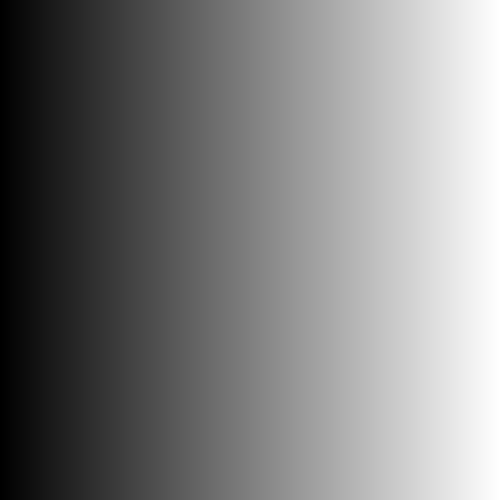
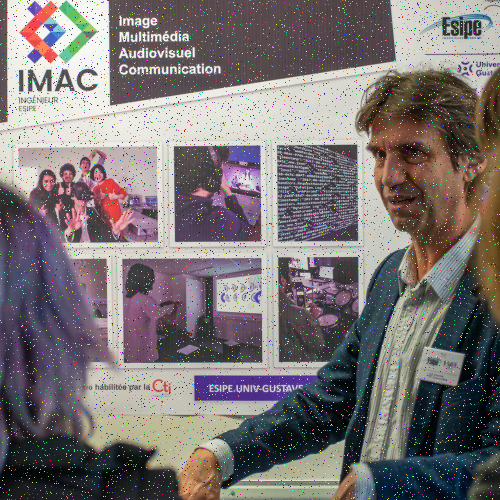
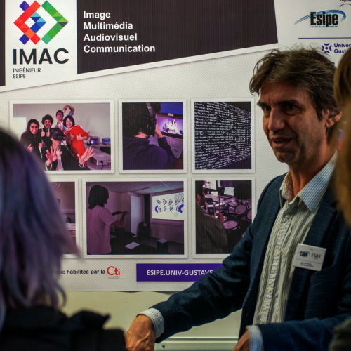
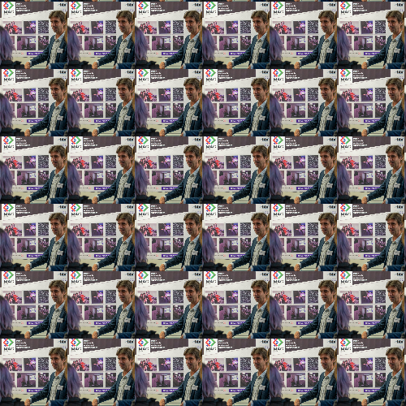

# WORKSHOP PROG & ALGO - Timothy Verdun

## Projet global 

## Exercice 1 : Onlygreen
| Avant | Après |
| :---: | :---: |
|  |  |

## Exercice 2 : Noir et blanc
| Avant | Après |
| :---: | :---: |
|  |  |

## Exercice 3 : Négatif
| Avant | Après |
| :---: | :---: |
|  |  |

## Exercice 4 : Dégradé
| Avant | Après |
| :---: | :---: |
| — |  |

## Exercice 5 : Miroir
| Avant | Après |
| :---: | :---: |
|  |  |

## Exercice 6 : Bruit
| Avant | Après |
| :---: | :---: |
|  |  |

## Exercice 7 : Rotation à 90°
| Avant | Après |
| :---: | :---: |
|  |  |

## Exercice 8 : RGB Split
| Avant | Après |
| :---: | :---: |
|  |  |

## Exercice 9 : Luminosité
| Avant | Après |
| :---: | :---: |
|  |  |

## Exercice 10 : Disque
| Avant | Après |
| :---: | :---: |
|  |  |

## Exercice 11 : Cercle
| Avant | Après |
| :---: | :---: |
|  |  |

## Exercice 12 : Rosace
| Avant | Après |
| :---: | :---: |
|  |  |

## Exercice 13 : Rétrécir l'image (`smallimg`)
| Avant | Après |
| :---: | :---: |
|  |  |

## Exercice 14 : Mosaïque (`mosaic`)
| Avant | Après |
| :---: | :---: |
|  |  |

## Exercice 15 : Glitch
| Avant | Après |
| :---: | :---: |
|  |  |

## Exercice 16 : Tri des pixels (`sortpixels`)
| Avant | Après |
| :---: | :---: |
|  |  |