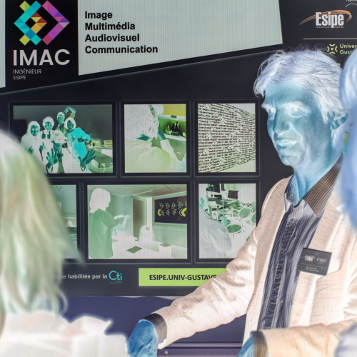
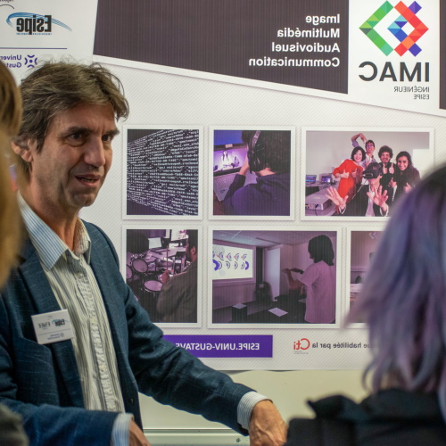
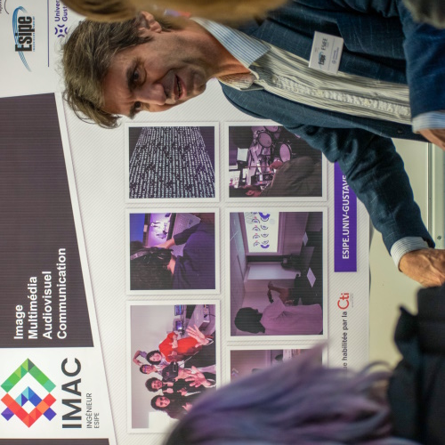
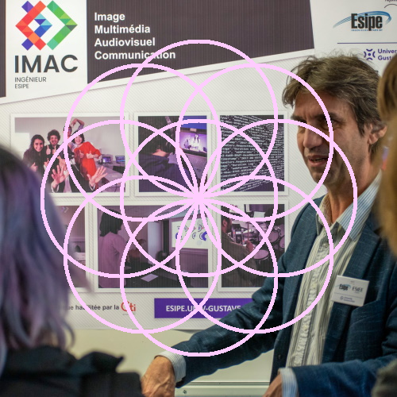
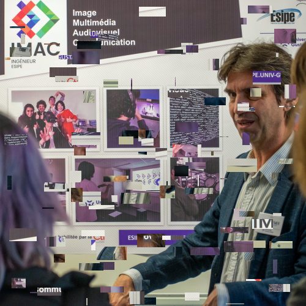
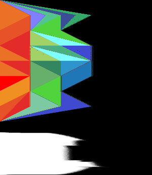

# WORKSHOP PROG & ALGO - Timothy Verdun

## Projet global 
Après avoir commencé les premiers exercices en créant une nouvelle fonction que j'appelais ensuite dans main à chaque fois, je me suis dit qu'il serait intéréssant de proposer un "menu" à l'utilisateur pour lui permettre de choisir simplement l'image et l'effet à appliquer. 
En faisant ça, j'ai fait plusieurs ajustements sur mes fonctions pour qu'elles soient plus flexibles et polyvalentes.

## Exercice 1 : Onlygreen
| Avant | Après |
| :---: | :---: |
|  |  |

## Exercice 2 : Noir et blanc
| Avant | Après |
| :---: | :---: |
|  |  |

## Exercice 3 : Négatif
| Avant | Après |
| :---: | :---: |
|  |  |

## Exercice 4 : Dégradé
| Avant | Après |
| :---: | :---: |
| — |  |

## Exercice 5 : Miroir
| Avant | Après |
| :---: | :---: |
|  |  |

## Exercice 6 : Bruit
| Avant | Après |
| :---: | :---: |
|  |  |

## Exercice 7 : Rotation à 90°
| Avant | Après |
| :---: | :---: |
|  |  |

## Exercice 8 : RGB Split
| Avant | Après |
| :---: | :---: |
|  |  |

## Exercice 9 : Luminosité
On demande à l'utilisateur une valeur de luminosité à partir de 0. (0 le plus clair, 2 plus foncé). Exemple avec lum_value = 0.5 :
| Avant | Après |
| :---: | :---: |
|  |  |

## Exercice 10 : Disque
| Avant | Après |
| :---: | :---: |
|  |  |

## Exercice 11 : Cercle
On dessine un cercle centré sur une image et on demande à l'utilisateur l'épaisseur du trait. Exemple avec thickness = 30 :
| Avant | Après |
| :---: | :---: |
|  |  |

## Exercice 12 : Rosace
| Avant | Après |
| :---: | :---: |
|  |  |

## Exercice 13 : Rétrécir l'image (`smallimg`)
On demande à l'utilisateur une valeur (entière) de réduction de l'image. Exemple avec une image 3 fois plus petite (div_size = 3) :
| Avant | Après |
| :---: | :---: |
|  |  |

## Exercice 14 : Mosaïque (`mosaic`)
On demande à l'utilisateur la taille de la mosaïque. Exemple avec une mosaïque de 4x4 (size = 4) :
| Avant | Après |
| :---: | :---: |
|  |  |

## Exercice 15 : Glitch
On demande à l'utilisateur la valeur du glitch. Exemple avec gain=60 (on fait 60 glitchs) :
| Avant | Après |
| :---: | :---: |
|  |  |

## Exercice 16 : Tri des pixels (`sortpixels`)
Tri horizontal des pixels.
| Avant | Après |
| :---: | :---: |
|  |  |
*Ici j'ai d'abord essayer de coder la méthode classique mais j'obtenait simplement une image avec 2 bandes colorées. J'ai donc préféré utiliser std::sort qui est bien plus simple et efficace.